<!-- evergreen:intro:start -->
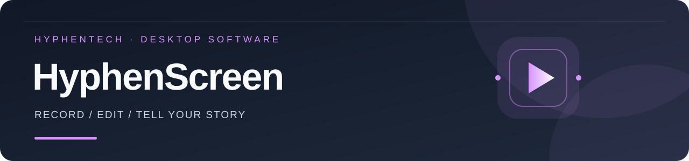

# 黑粉錄屏 HyphenScreen · 錄製、剪輯與原生動畫

**錄好關鍵操作，用圖片、動畫和配音完成整條影片。**

黑粉科技的桌面錄屏與智慧剪輯軟體，適合軟體教學、產品示範、知識分享和口播影片。在同一個視窗完成錄製、多軌剪輯、字幕、聲音處理、原生動畫和匯出，也可以用自然語言請 AI 協助修改。

<a href="README.md">简体中文</a> | <a href="README.zh-TW.md">繁體中文</a> | <a href="README.en.md">English</a> | <a href="README.ja.md">日本語</a>

 

<!-- evergreen:intro:end -->

<!-- recent-features:start -->
## 近期新增與改進（最近 5 項）

- **1.7.2** · 修復標題命名工程刪除後重新出現；依實際檔案刪除，防止延遲儲存重建工程，錄製素材保留。
- **1.7.1** · 修復部分攝影機錄製切換去背、模糊或自訂背景後人物消失的問題，保留現有素材與剪輯。
- **1.7.0** · 匯出浮水印預設「黑粉录屏」，可關閉，MP4與GIF同步生效。
- **1.7.0** · 自訂文字、圖片或組合，四種署名範例、五種位置及大小／不透明度設定，實際匯出時記住選擇。
- **1.6.9** · 本機編排擴為八類：證據、過程、人物、前後對比、數據、清單、時間與結構，固定任務無需模型。
<!-- recent-features:end -->

**1.7.2** · 修復專案刪除後重新出現：依實際檔案定位，依序處理儲存與刪除，阻止延遲儲存重建已刪除專案。 Windows／Linux已在本機建置；Mac版本以實際下載表為準。Mac開發版專項及自動測試不代表其他系統的桌面實測。

**1.7.1：摄像头背景切换修复。** Mac上部分实际摄像头录制使用软件解码，切到抠图、模糊或自定义背景后人物可能消失。本版修复分割遮罩与视频帧的关联，保留现有素材、剪辑和分割模型；无需重录。Windows与Linux现已本地构建至1.7.1；摄像头背景修复仅适用于Mac，不扩大为其他平台的修复或实测。

**1.7.0：匯出浮水印由你決定。** Mac的匯出設定預設顯示「黑粉录屏」，可關閉，也可設定自己的文字、本機PNG／JPEG／WebP圖片或兩者組合。四個範例可直接套用，支援五種位置、大小與不透明度；文字隨畫面明暗調整。實際匯出時儲存設定，MP4與GIF共用原生疊加路徑。本版尚無收費限制；Windows／Linux1.7.0已同步上述浮水印設定。已核驗原生及應用程式命令列輸出，桌面滑鼠匯出流程因系統擷取畫面故障未記為通過。

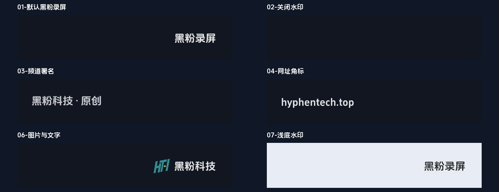

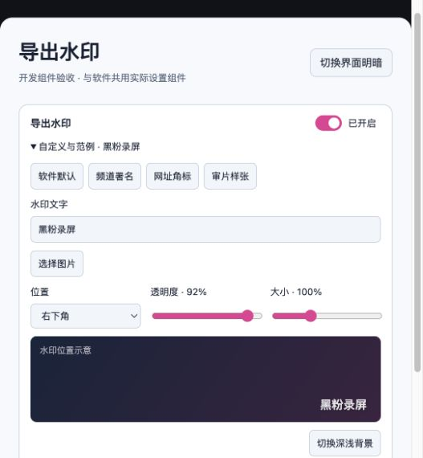

**1.6.9：八類本機編排，先看成片再填內容。** Mac提供來源證據、原理過程、角色講解、前後對比、數據對比、重點清單、時間脈絡、結構拆解。兩套配色共16個12秒真實範例，先播放，再修改文字、數據與節拍，無需模型即可產生原生可編輯圖層。角色使用同一人物的六張完整姿態插畫，支援統一講解圖與各階段配圖。窄檢查器採兩列卡片，套用區不遮擋內容，原生圖片補齊WebP解碼。Windows／Linux1.7.0已在本機建置並包含上述功能；固定框架及六姿態不代表自由骨架或任意故事產生能力。

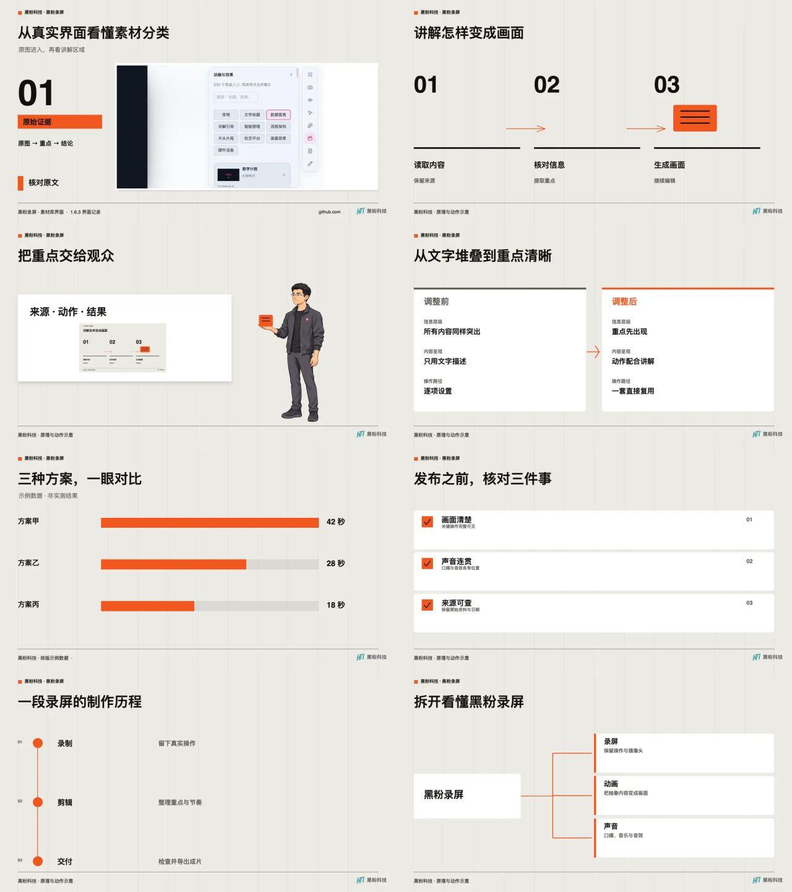

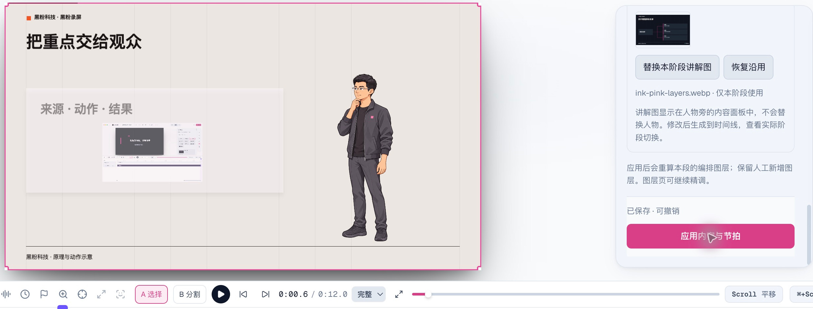

**1.6.8：內容與動作共用一份節拍。** Mac在「製作動畫」中加入「本機編排」，來源證據、原理過程和角色講解無需模型即可產生原生圖層。動畫的「內容」頁可改文字、圖片、步驟及事件時間；動作與既有音效共用節拍。可固定在專案時間尺或跟隨一個主錄影片段，連續相容編排優先共軌。重新編排會重算受控圖層，保留人工新增圖層；這是三類固定任務框架，不是通用骨架或任意故事產生器。Windows／Linux1.7.0已包含上述功能。

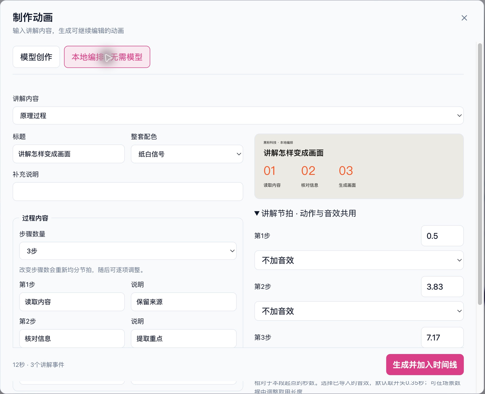

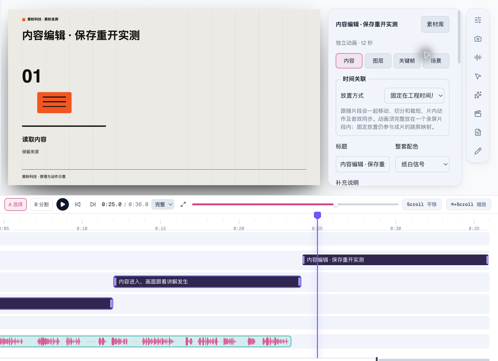

**1.6.7：整片包裝更緊湊。** Mac編輯視窗將片段選擇合為一組，縮圖、標題、版式與時間集中顯示，再用「本段版式」修改目前片段。十套名稱統一四字，「昭和海報」改為「紅色海報」；舊專案、配色與聲音保持相容。一般四段設定在1280×720視窗可完整顯示，較小視窗與更多片段按需捲動。Windows／Linux1.7.0已包含上述介面更新。

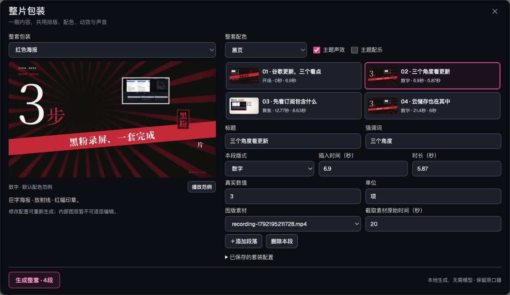

**1.6.6：Windows／Linux整片包裝編碼修復。** 使用隨包提供的OpenH264，修復產生時找不到libx264的問題，無需另外安裝編碼器。Mac現提供1.7.0，平台版本及驗證範圍見下載表與發行說明。

**1.6.5：十套整片包裝，一期共用設計。** 開啟專案，在AI面板選擇「整片包裝」。每套含開場、清單、聚焦、數字四種版面，先看真實範例再填內容；每組1至12段，在本機產生並整組加入，保留原口播。主題音效預設開啟、配樂預設關閉；修改已儲存設定可替換原組，人工調整過的片段受到保護。片段可剪輯，內部圖層暫不可逐層編輯。Apple晶片Mac已完成十套預設配色匯出及真實錄屏四段的產生、跳轉、續播、儲存重開專項；其他平台依實際下載表為準。

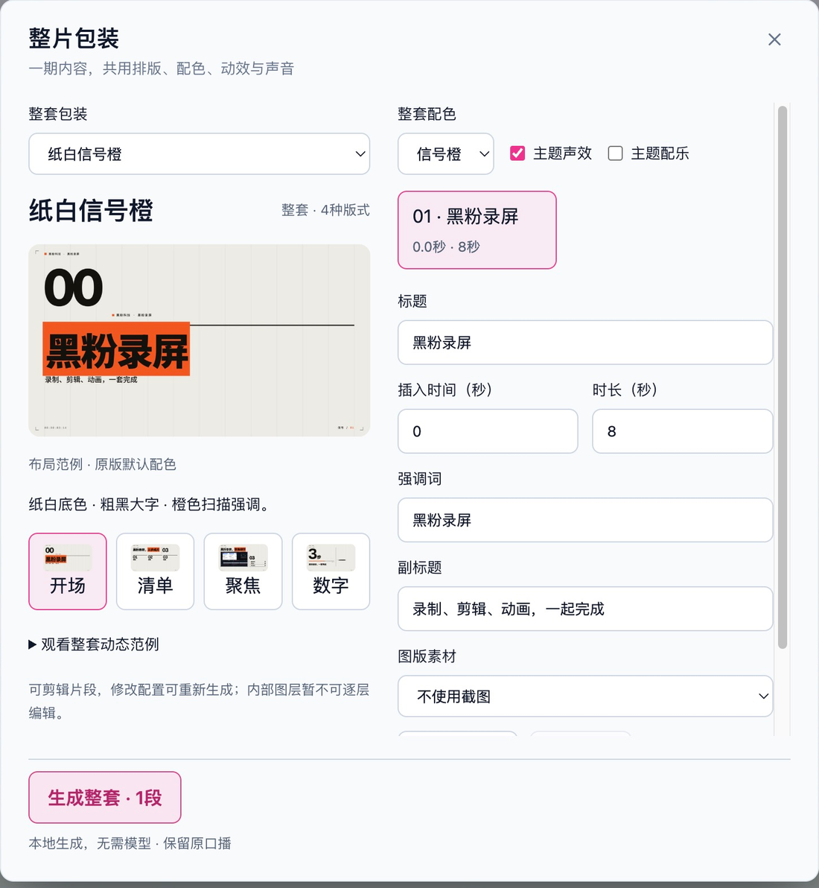

**1.6.4：游標跟隨與縮放更穩。** 選取縮放片段，在右側對焦模式選擇「穩重講解」或「靈敏示範」。小範圍操作保持構圖，越界後平滑跟隨；連續點擊依時間與位置組成操作段，縮小退出時保持焦點。需要錄屏的游標軌跡，外部影片可使用手動焦點。舊專案保留原有跟隨。Mac、Windows與Linux均提供1.6.4。Mac完成真實錄屏專項，Windows完成合成範例原生匯出，Linux完成包體及安裝校驗；桌面互動範圍見發行說明。

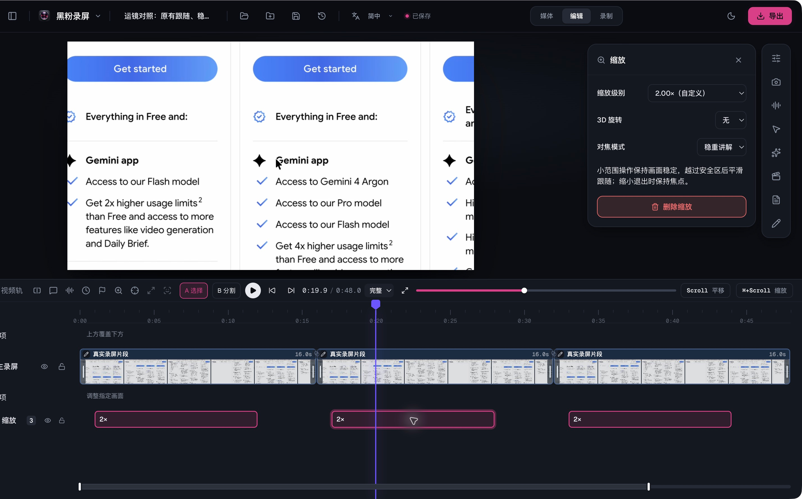

**1.6.3：素材依用途合併，常用內容更好找。** 動畫與效果庫整理為230個入口、九類用途；章節、圖表、終端等跨來源樣式合併，保留原素材和舊專案。新增統計環、終端模擬、程式碼輸入及對話示範等中文範例。模型依素材類型篩選時，也能找到混合樣式系列中的素材。上述素材能力在Mac1.6.5與Windows／Linux1.6.6中繼續保留，安裝包依下方下載表為準。

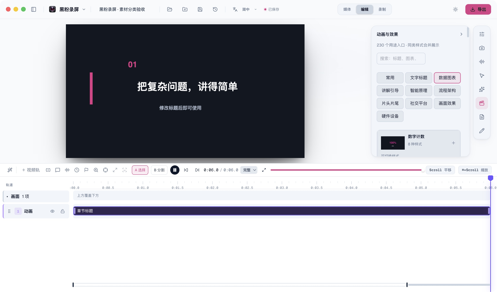

<!-- development-timeline:start -->

**1.6.1：修復調整時間軸後的背景音樂重疊播放。** 預覽退回即時混音前先停止舊預混音，延遲起播也核對目前模式。包含1.6.0的動畫定位與分層橫移修復；1.6.0僅產生本機測試包。各平台版本以下載表為準。

**1.6.0：修復跳剪後動畫閃入錯誤位置。** 入場、離場及來源標籤依編輯時間軸實際位置合成，避免前面跳剪後延遲疊到主錄屏；預覽與匯出同時修正。Mac提供此修復，其他平台版本以下載表為準。

主錄屏抬到獨立畫面軌道後，可繼續橫向調整時間，其他片段保持原位置；單一主軌保留原有排序方式。

**1.5.9：跳剪、刪除聯動與相容內容共軌。** 整段跳剪可調起止；刪除主錄屏後，後續獨立畫面與聲音連動前移。編輯介面支援同類且時間不重疊的物件共軌，拒絕鎖定、不相容及衝突目標。本期51條動畫軌整理為3條，內容與重疊覆蓋順序保留。續播與播放器釋放已有修正；長時間編輯的同一播放器錯誤未穩定重現，不宣稱完全解決。

**1.5.9：跳剪與續播改進。**「新增跳剪」預設涵蓋目前整段影片，使用雙端範圍條調整起止；刪除主錄屏片段會讓後續獨立素材一起前移。片尾跳剪後可重新播放，素材清單變更時按素材身分保留預覽來源。實際發行與驗收範圍見原始碼進度記錄。
<!-- style-preview-156:start -->

**1.5.8：動畫專案直接預覽。** 原生動畫搭配旁白及音樂時使用動畫畫布，不再把音訊誤當影片。預覽來源依實際畫面時間軸選取，外部編輯介面同時修復場景輸入結構相容問題。macOS獨立編輯器已驗證跳轉與整片連續播放；安裝及平台狀態見發行說明。

**1.5.7：動畫等待與即時回饋。**「製作動畫」的粉色時鐘按鈕可分別設定最長等待及無輸出等待（1–360分鐘），依引擎記住。解釋和分鏡隨模型文字顯示；支援參數增量時回報場景結構進度，每次寫入後自動讀回圖層數與時長。結束後可展開過程。部分訂閱不提供參數流，僅顯示真實階段。macOS 1.5.7包含此改進；完整故事的生成品質仍需由使用者預覽核對。
### 先看樣式，再製作動畫

19種風格均以簡體“黑粉录屏”統一展示典型矢量範例。懸停或鍵盤聚焦可預覽動作，點選後可播放／暫停較大範例；寬視窗左側填寫解說、右側選風格，窄視窗兩欄排列，跨分類保留選擇與輸入。

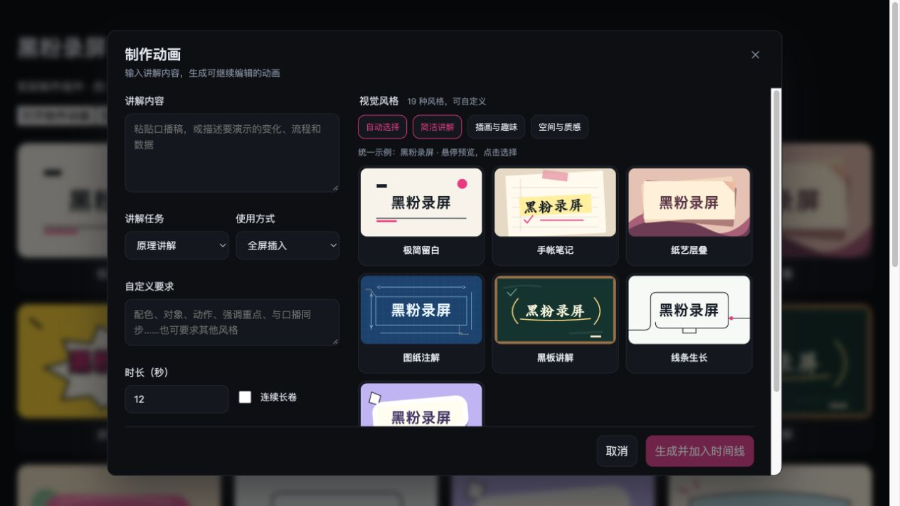

[查看19種風格總覽](screenshots/animation-style-previews-gallery.png)。截圖來自實際元件的瀏覽器驗收頁；內建範例用於解釋風格，並非模型生成結果，物件與動作仍依本次解說設計。

macOS匯入影片遇到硬體解碼失敗時，會為目前素材嘗試軟體解碼並保留播放位置；正常硬體路徑不變，不轉碼或修改工程。六段素材原生預覽及失敗恢復已驗證，完整安裝桌面驗收未計通過。
<!-- style-preview-156:end -->

### 1.5.3：軌道更緊湊，剪完直接播放

同類且時間不重疊的標註、圖片、疊加效果及動畫，可拖到目標軌道中部合軌，也可右鍵選擇目標；原軌移空後自動隱藏。拖到軌道上下邊緣調整畫面層級，橫向仍調整時間。新標註沿用可見、未鎖定的標註軌，重疊內容在同軌分行。鎖定、隱藏或時間衝突的目標不會強行接收素材。

字幕、圖片、動畫、標註及影片仍以上方覆蓋下方，聲音獨立混音。分組僅由左側表頭收合；自動字幕預覽與匯出恢復，大段刪除或裁切後無須切頁即可續播。macOS已完成實際桌面及原生媒體驗收，各平台可用版本請見下載表。
<!-- development-timeline:end -->

<!-- development-animation-authoring:start -->
### 1.5.1：19種方法，依解說製作動畫

**1.5.3 Kimi 實測**：相容介面不再因動畫曲線參數返回400。`k3-256k` 已實際生成8秒、14圖層的原生動畫，含兩處自訂貝塞爾緩動，寫入、讀回與原生匯出通過。使用自己的介面、模型及金鑰，先測試工具往返，再使用「製作動畫」；此為單次實測，並非所有模型與風格均已驗證。

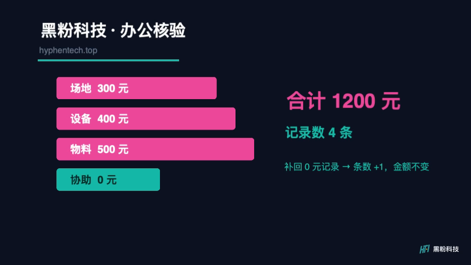

開啟 AI 面板的「製作動畫」，輸入解說與自訂要求，從簡潔解說、插畫趣味、空間質感三組19種方法中選擇，設定長度、插入位置或連續畫面。跨分類保留選擇；模型按需讀取一種方法，重新設計物件、動作及鏡頭，寫入可編輯圖層、關鍵影格及動畫片段。精製指引包含空間層次、功能動態、次級回應及閱讀停留。支援獨立無聲動畫、透明疊加與全螢幕插入，不需要墊影片。

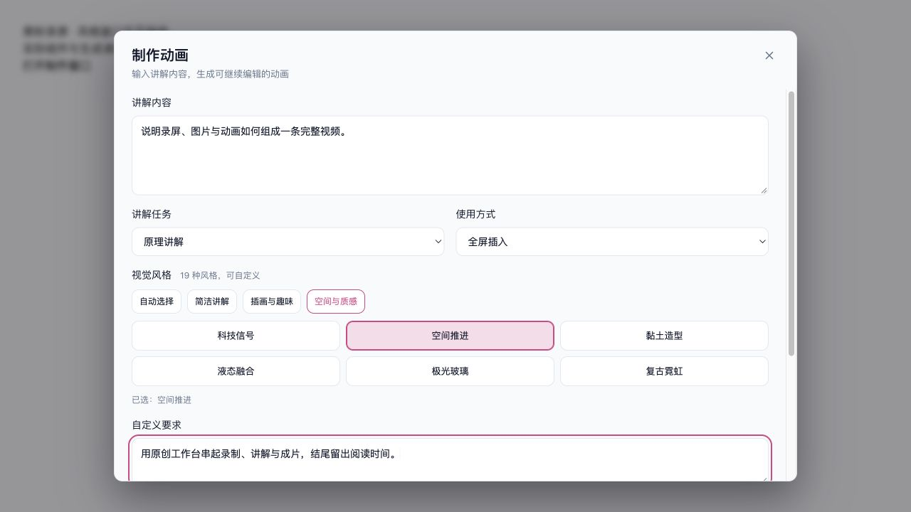

上圖是軟體實際製作元件的瀏覽器驗收截圖，展示本版介面，不代表一次模型生成或完整桌面驗收。

方寸智匣自動發現已載入的語言模型；本機 Qwen3.8 27B 已完成實際自由場景生成、工具寫入、工程讀回及原生匯出。此次八秒紙藝去重生成約六分四秒，為單次實測，不是速度保證。訂閱模型也已生成及匯出紙藝分流、去重與二維水循環長卷；19種方法尚未逐項完成模型生成品質驗收，不保證所有題材達到參考級紙藝或繪畫品質。真實三維、折射及流體採用外部製作路線，獨立參考影片與私有樣片不冒充軟體內生成。

設定提供「測試連線與工具呼叫」，核實目前模型及介面的實際往返，不儲存測試草稿、不修改工程。「已設定金鑰」不等於認證通過，MiniMax 候選目錄不自動付費探測。對話訊息與忙碌狀態分別保存，本地雙對話與訂閱並行切換已實測；上下文只顯示對話估算，不代表完整模型占用。
<!-- development-animation-authoring:end -->

<!-- evergreen:demos:start -->
## ▶ 使用示範

**錄影設定、滑鼠縮放、動畫與 AI 口播精剪**

| Bilibili | YouTube |
| :---: | :---: |
|  |  |

影片示範的是拍攝時的版本；安裝套件與目前功能以本頁正式發行資訊為準。影片以中文講解。
<!-- evergreen:demos:end -->

## 下載: 1.7.2

| 平台 | 安裝套件 | SHA-256 |
|---|---|---|
| macOS 13+（Apple 芯片 arm64） | [下載 HyphenScreen_1.7.2_arm64.dmg](https://github.com/HackerChi-Hub/HyphenScreen-Releases/releases/download/v1.7.2/HyphenScreen_1.7.2_arm64.dmg) | `fa1a488c6ebfab8b21403ab986e841be5ff574beededa6205f298fe8408adb3d` |
| Windows 10/11（x64） | [下載 HyphenScreen_1.7.2_x64-setup.exe](https://github.com/HackerChi-Hub/HyphenScreen-Releases/releases/download/v1.7.2/HyphenScreen_1.7.2_x64-setup.exe) | `84ae067376c105ac25645dd8bd3e7c76d161da069a2d34124acd09577199919f` |
| Linux（x86_64）· 1.7.1 版 | [下載 HyphenScreen_1.7.1_x86_64.AppImage](https://github.com/HackerChi-Hub/HyphenScreen-Releases/releases/download/v1.7.1/HyphenScreen_1.7.1_x86_64.AppImage) | `38ff038029fbe8af9a7ebbdec7bbed673fb6bb0ad6efb522f1c0def5e467d43f` |
| Debian / Ubuntu（amd64）· 1.7.1 版 | [下載 HyphenScreen_1.7.1_amd64.deb](https://github.com/HackerChi-Hub/HyphenScreen-Releases/releases/download/v1.7.1/HyphenScreen_1.7.1_amd64.deb) | `263ebe788026f7cea733f1fa05f5f2ed407f992179b40583a7387aa26c6b87c4` |
| Arch Linux（x86_64）· 1.7.1 版 | [下載 HyphenScreen_1.7.1_x64.pacman](https://github.com/HackerChi-Hub/HyphenScreen-Releases/releases/download/v1.7.1/HyphenScreen_1.7.1_x64.pacman) | `f6c811f0ff52f2e6d5e8926de53e6e0dc6863d7d34402062a41a2df0c8423ec8` |

<!-- evergreen:capabilities:start -->
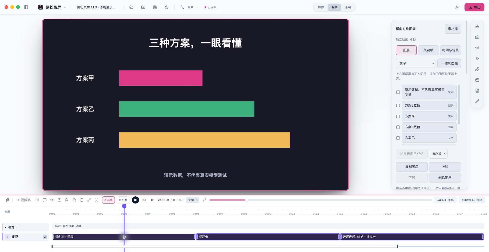

## 一個視窗，完成整個流程

| 環節 | 功能 |
|---|---|
| 錄製 | 螢幕、視窗或區域；攝影機、麥克風、系統聲音；錄製設定與滑鼠軌跡 |
| 剪輯 | 批次匯入影片／音訊，多影片軌道，上層畫面覆蓋、聲音混音 |
| 畫面 | 等比例畫框、子母畫面、上下／左右分割、全攝影機與脈衝描邊 |
| 字幕 | 本機轉寫、手動改字、搜尋、多組樣式與中文換行 |
| 聲音 | 獨立裁切、逐段音量、人聲處理、均衡與背景音樂閃避 |
| 動畫 | 獨立場景、圖層、關鍵影格、緩動、時長與速度 |
| AI | 訂閱登入、本地模型、自選 API、快速處理範本與 MCP 工具 |
| 匯出 | MP4／GIF、橫式／直式、編碼與解析度、打碼與成片檢查 |

## 動畫自己生成畫面

動畫片段不需要墊底影片，可帶背景。只錄開頭與必要操作，其餘搭配圖表、標題、圖片、影片素材及匯入的 TTS 配音。文字、圖片、形狀、向量圖形、圖表和箭頭组成圖層；支援順序、分組、多選、隱藏與鎖定。位置、尺寸、透明度、旋轉、顏色與支援的數值可設定關鍵影格和緩動。

Rust 合成器逐影格計算，預覽和匯出共用場景邏輯；AI 修改 JSON 場景資料，不需要執行 Remotion 程式碼。在預覽中拖曳物件，或精確輸入數值。開始時間、時長、速度可調，支援播放一次、循環、保持末影格和直接靜態顯示。

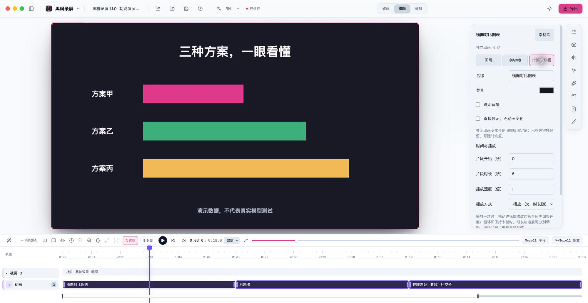

## 素材依用途分類，同類樣式合併

統一「動畫與效果」入口，分為常用、文字標題、資料圖表、講解引導、品牌片尾、社群平台、畫面效果、硬體裝置、AI 原理、流程架構。目前 **230 張分類入口卡**，其中 **71 張講解引導**依指引標註、步驟流程、對比關係和場景示範篩選。23 個語錄／觀點示例合為一個文字標題家族，樣式在面板切換。標題簡短、可換行，原名仍可搜尋。

內建常用動畫 16 種，另有 17 平台社群卡；參考遷移預覽 380 項；另有 300 個由 LottieFiles 免費動畫轉換的原生動畫。同類配色和樣式不再重複堆卡。遷移預覽的完整來源參數重算、複雜濾鏡和動態視覺一致性仍待完善，並非全部參考範例的完整複製。

跨來源系列包含13種章節、22種標題、10種人物介紹、6種引用卡、4種環形進度與6種終端樣式。裝飾圖標與數值圖表分開。範例文字及網址統一為黑粉科技中文內容，必要第三方許可與來源保留。

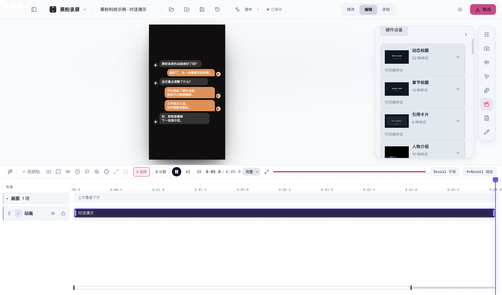

社群卡支援抖音、快手、嗶哩嗶哩、小紅書、微信影片號、微信公眾號、微信、微博、知乎、今日頭條，以及 YouTube、TikTok、Instagram、X、Facebook、LinkedIn、Twitch。切換平台保留已修改的帳號、標題和正文。

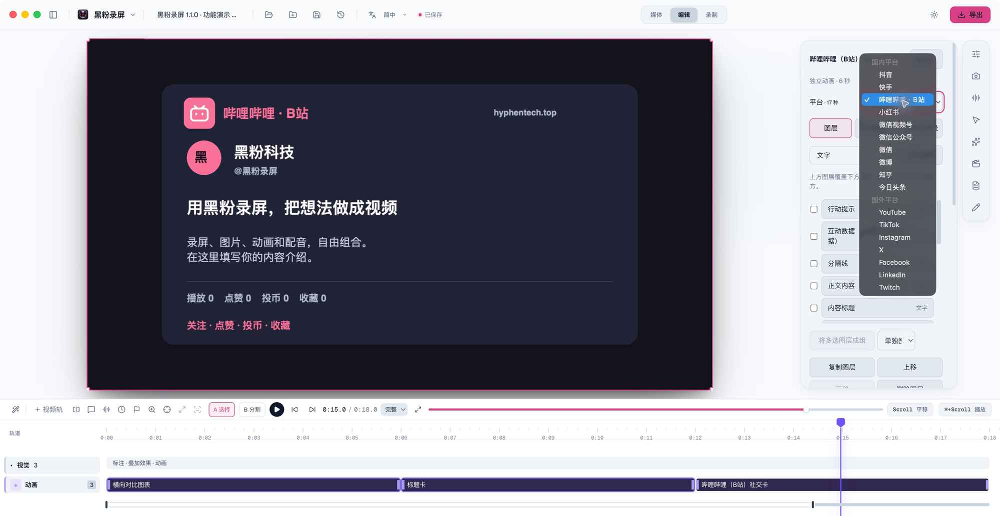

## 多軌、攝影機與聲音

影片轨道不設固定數量上限，上層可見畫面覆蓋下層、音訊疊加混音。拖動片段兩端裁切或恢復來源內容，支援分割、移動、標記、轉場、分類右鍵選單與逐影格微調。標註、疊加效果和動畫放在可展開的「視覺」分組，支援混合框選與一次復原；無素材的軌道自動隱藏。

預覽中的畫面、攝影機、字幕及適用標註／範本可直接拖動和縮放。保留畫面比例，框架不拉伸內容；錄製後可依滑鼠停留推薦平滑縮放。攝影機支援子母畫面、左右／上下分割，跨片段全螢幕區間可硬切或平滑進入，描邊可調粗細、顏色和漸層脈衝。攝影機背景模糊、去背和替換目前僅 macOS。

字幕可手動修改、搜尋定位與恢復原文，調整字級、顏色、底板、位置和換行。音訊可獨立裁切、分離原聲、逐段調音量（-60 至 +36 dB）。背景音樂閃避有自然背景、口播均衡、口播優先三種設定，可調提前量、停頓保持與恢復。人聲隔離目前僅 macOS，波形隨時間軸放大呈現細節，切分後保留來源時間。

## 自帶 AI，減少重複操作

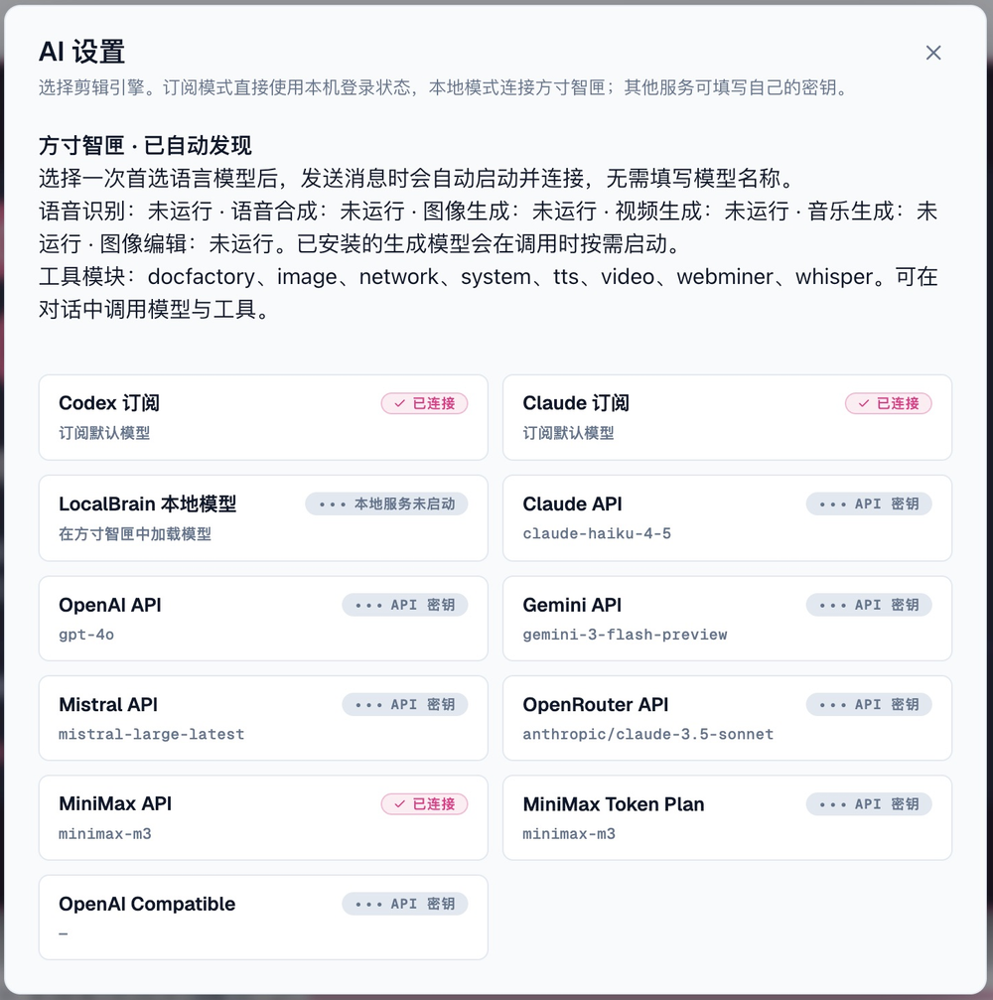

Codex／Claude 訂閱偵測本機官方客戶端與登入狀態，失敗時顯示明確的登入／重新登入指引，Codex 有登入備援入口。LocalBrain 可發現方寸智匣並按需連接首選語言模型；可用性依實際服務狀態與模型回覆判定，並非所有模型均已逐一驗證。

API 支援 Kimi 訂閱（預填接口與模型）、OpenAI、Claude、Gemini、Mistral、OpenRouter、MiniMax、MiniMax Token Plan 及相容接口；各提供商的模型與位址分別保存，切換不遺失；MiniMax 國內／國際位址分開配置。快速範本涵蓋口播精剪、停頓、口頭禪、重複重錄、人聲處理、音樂閃避、縮放、打碼、橫轉直與成片檢查。目前 MCP 提供 **92 個工具**，涵蓋已實作的工程、時間軸、字幕、音訊、動畫與匯出操作。AI 修改請在預覽中複核。

## 匯出、保護與工程管理

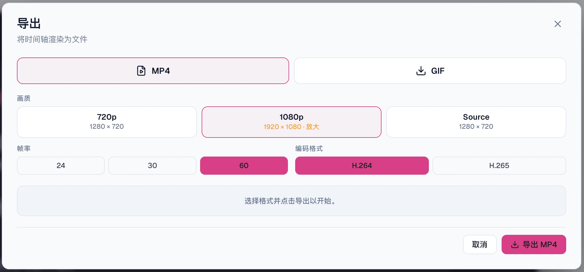

選擇 MP4／GIF、解析度、影格率與 H.264／H.265。超過來源尺寸的「放大」代表上採樣，不會補出原素材沒有的細節。可將橫式精彩片段改為 9:16。成片檢查涵蓋響度、靜音、黑畫面、卡影格、時長和文字邊界；自動敏感文字辨識及匯出後文字回讀目前僅 macOS，手動打碼各平台可用。

工程、錄製和快取資料夾可自訂到外接硬碟，分類清理快取，利用自動或命名版本記錄恢復工程。

## 下載與平台範圍

軟體可免費下載，不需要黑粉錄屏帳號；模型訂閱和 API 使用自己的帳號、金鑰與額度。錄製和工程保存在本機，雲端 AI 會收到本次請求相關的對話和工程資訊；本地模型推理可留在電腦上。匿名裝置計數可關閉。

- **macOS：** 13 以上、Apple 晶片；DMG 使用本機憑證簽署，未做 Apple 公證。
- **Windows：** 10／11 x64、D3D11 影片解碼；安裝程式未做程式碼簽署。
- **Linux：** x86_64、glibc 2.35 以上、Vulkan 和桌面入口；AppImage、deb、pacman。

1.6.3開發工作室已核實用途分類、搜尋、插入與動畫播放；三組跨來源切換通過真實介面保存及獨立環境重開檢查。各素材仍保留自己的編輯限制。安裝、包內檢查及公開下載回讀記錄於發行證據；本輪未重跑完整錄製、實體攝影機或線上生成，Windows／Linux桌面仍待實機驗證。

版權所有 © 2026 黑粉科技。必要第三方授權及原始聲明隨軟體附帶；本公開倉庫提供安裝包和說明，原始碼維持私有。
<!-- evergreen:capabilities:end -->

<!-- evergreen:discovery:start -->
## 更多黑粉科技自製軟體

[LocalBrain](https://github.com/HackerChi-Hub/localbrain-releases) · [HyphenScreen](https://github.com/HackerChi-Hub/HyphenScreen-Releases) · [ScreenLex](https://github.com/HackerChi-Hub/screenlex-download) · [HyphenBox](https://github.com/HackerChi-Hub/hyphenbox-release)
<!-- evergreen:discovery:end -->
